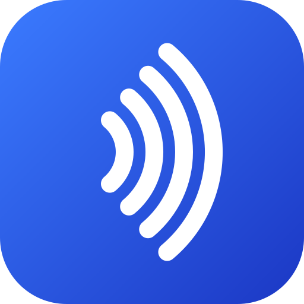
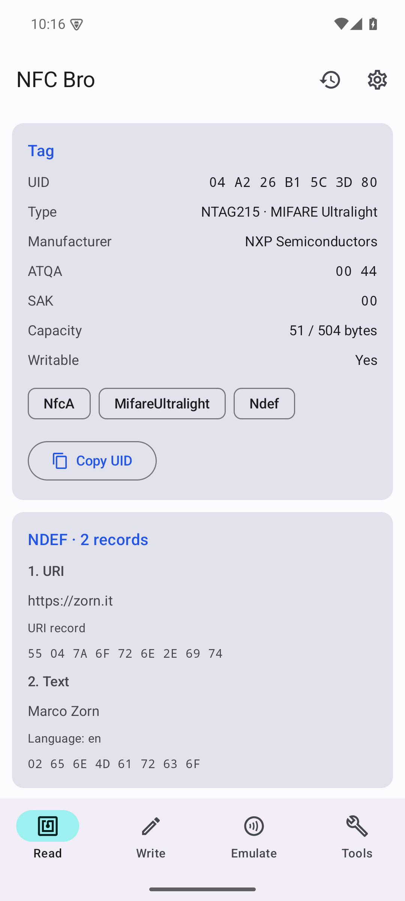
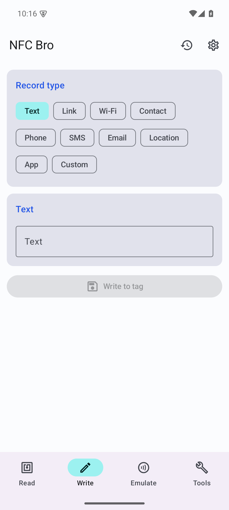
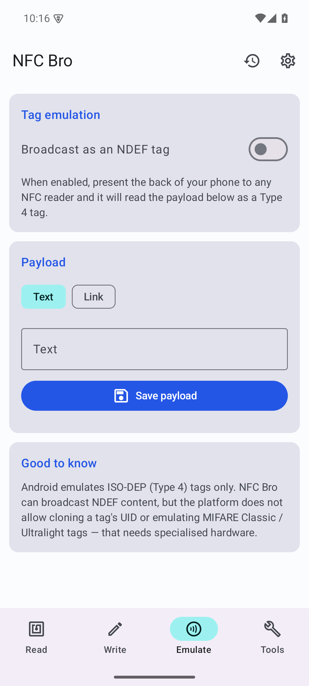
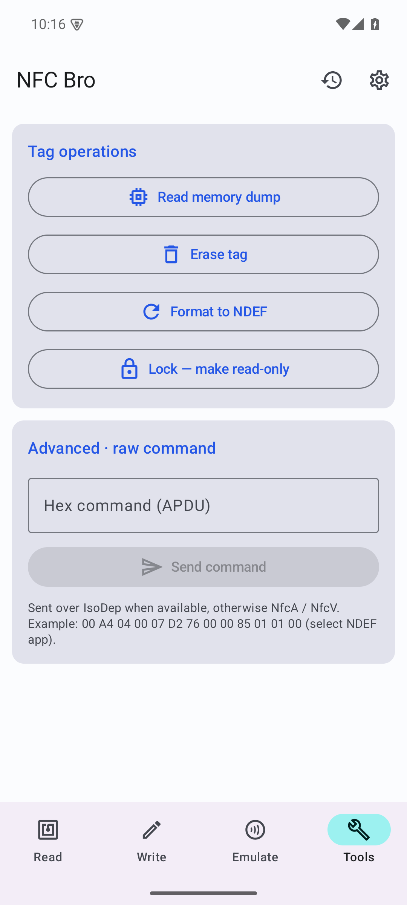

<div align="center">



# NFC Bro

**A fast, low-power NFC toolkit for Android — read, write, emulate.**


</div>

NFC Bro is a clean, modern NFC utility built from scratch in Kotlin with Jetpack
Compose and Material 3. It reads any tag, writes every common record type,
dumps raw memory, sends raw commands, and can broadcast an NDEF tag over Host
Card Emulation — all with an interface that gets out of the way and a scanner
that only runs while you're looking at it, so it barely touches your battery.

<div align="center">






</div>

## Features

### Read
- Full tag identity: UID, technology list, tag type, and chip manufacturer
- Low-level detail: ATQA, SAK and ATS
- NDEF capacity (used / total) and writable / read-only status
- Decodes NDEF records: Text, URI, Wi-Fi, contacts, Android App records,
  Smart Posters, MIME payloads and more
- Reads from the discovery cache — no connection, no wasted power

### Write
One-tap writing for every record people actually use:

| | | |
|---|---|---|
| Text | Link / URL | Wi-Fi network |
| Contact (vCard) | Phone number | SMS |
| Email | Location (geo) | Play Store app |
| Custom MIME | | |

### Emulate
- Broadcast a Text or URL payload as an **NFC Forum Type 4 tag** over Host Card
  Emulation — present your phone to any reader and it reads back your content
- Honest about the platform: stock Android cannot clone a UID or emulate
  MIFARE Classic / Ultralight, and NFC Bro says so instead of pretending

### Tools
- **Memory dump** for MIFARE Ultralight, MIFARE Classic (with the common default
  keys) and ISO 15693 (NfcV)
- **Erase**, **format to NDEF**, and **lock** a tag permanently read-only
- **Raw command console** — send APDUs / raw frames over IsoDep, NfcA or NfcV and
  read the response in hex

### The rest
- Scan **history** with per-tag detail
- **Material You** dynamic colour (optional), light / dark / system themes
- Haptic and sound feedback toggles
- Single screen, no ads, no tracking, no account

## Supported tags

NfcA / NfcB / NfcF / NfcV · IsoDep · NDEF & NDEF-formatable ·
MIFARE Classic · MIFARE Ultralight / NTAG · ISO 14443 & ISO 15693.

## Install

Grab the latest signed APK from the [**Releases**](https://github.com/MarcoZorn/nfc-bro/releases) page and open it on your phone.
You may need to allow installing from unknown sources.

Requirements: Android 7.0 (API 24) or newer, with NFC hardware.

## Build from source

Requires JDK 17 and the Android SDK (compileSdk 35).

```bash
git clone https://github.com/MarcoZorn/nfc-bro.git
cd nfc-bro
./gradlew assembleRelease      # or assembleDebug
```

The APK lands in `app/build/outputs/apk/`.

To sign a release build, drop a `keystore.properties` in the repo root:

```properties
storeFile=/absolute/path/to/keystore.jks
storePassword=…
keyAlias=…
keyPassword=…
```

## How the low-power scanning works

NFC Bro uses `enableReaderMode` and only turns the reader on while the app is in
the foreground; it's shut off the moment you leave. There are no background
services, no polling loops and no wake locks. The read path never opens a
connection to the tag — it parses the data the OS already cached during
discovery. Emulation only draws power when a reader is actively talking to it.

## Tech stack

Kotlin · Jetpack Compose · Material 3 · Android NFC (`android.nfc`,
`HostApduService`) · kotlinx.serialization. No third-party NFC libraries — the
protocol handling is all first-party.

## License

[MIT](LICENSE) © Marco Zorn
